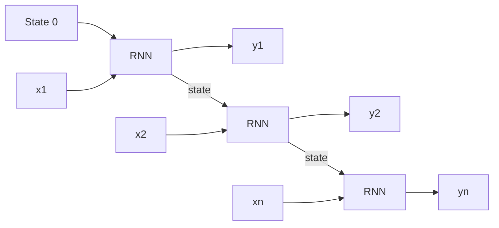
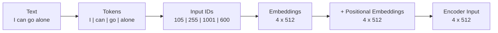
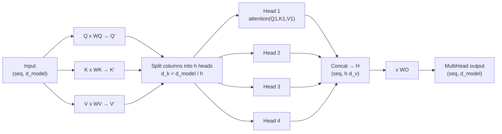
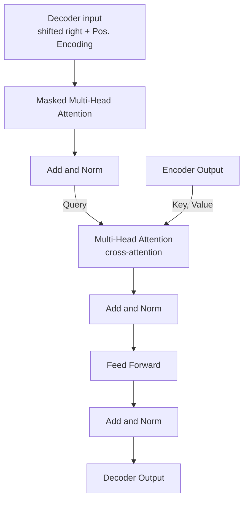
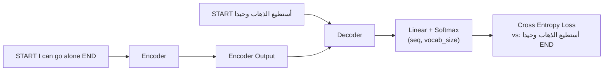
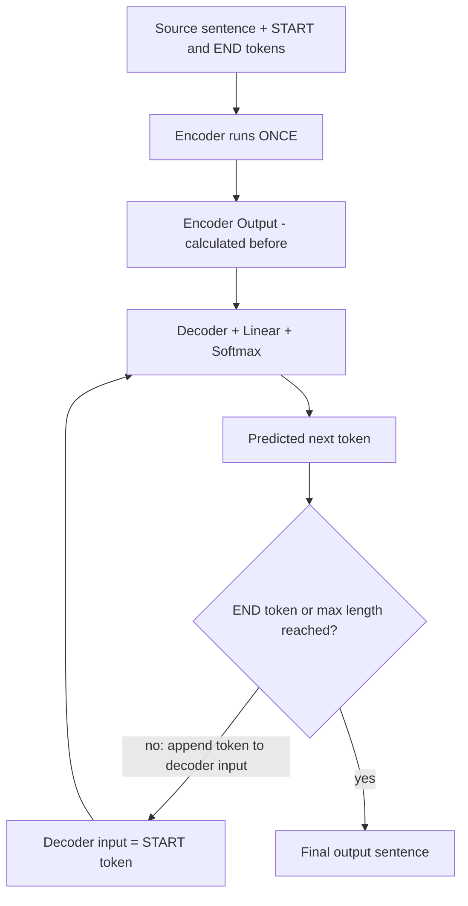

# Introduction to Transformers — Attention is All You Need

> **⬅️ Previous:** —  |  **➡️ Next:** [[2. Dataset Exploration]]
> **📂 Course:** [[LLM From Scratch - Index]]

> **الهدف من الجلسة**: فهم الـ Transformer architecture من الأساس خطوة بخطوة — Encoder ثم Decoder ثم Training ثم Inference — وفلسفة ليه اتبنى كده. ده الأساس اللي هنبني عليه الـ GPT بتاعنا في باقي الكورس.

> [!quote] افتتاحية المهندس
> «لو انت شغال في المجال ده ومش فاهم الـ architecture من جوه، فاتك كتير — لأن الترانسفورمر بقى حجر أساس في الحلول. حاول تشرب قهوة وركّز معايا، والموضوع هيكون أبسط مما تتخيل.»

> [!info] مكان المحاضرة في الكورس
> **Section 1: Basics** ← المحاضرة 1 (دي) ← المحاضرة 2: Dataset Exploration. الـ slides: 37 slide (Abu Bakr Soliman). الأرقام بين قوسين `(Slide N)` بترجّعك للـ PDF.

> [!abstract] TL;DR
> - الـ Transformer = **Encoder + Decoder** بيعتمد على **Attention** بدل الـ RNN → بيتدرّب **parallel** ومفيش vanishing memory.
> - الـ Encoder: `Tokens → IDs → Embeddings + Positional → (Multi-Head Attention → Add & Norm → FFN → Add & Norm) → Encoder Output`.
> - الـ Decoder: نفس الفكرة + **Masked Attention** (مفيش غش) + **Cross-Attention** (Q من الـ Decoder، K/V من الـ Encoder Output).
> - **Training** = الجملة كلها في time step واحدة. **Inference** = token by token لحد `<E>` أو max length.
> - الأبعاد ثابتة طول الطريق: `(seq, d_model)`.

---

## 🧠 الجزء 1 — الخلفية: ليه Transformers؟

### 1. Seq2Seq و مشاكل الـ RNN (Slides 2–4)

**Sequence-to-Sequence**: عندك input عبارة عن sequence (جملة = متتالية كلمات) وعايز output هو كمان sequence. كل كلمة بنسميها **time step**: $x_1, x_2, \dots, x_n \rightarrow y_1, y_2, \dots, y_n$. مثال: Machine Translation (عربي ← إنجليزي).

**الـ RNN (الحل القديم)**: بياخد الـ sequence **واحدة واحدة**، وفي كل خطوة بياخد الـ input الحالي **+ State** جاية من الخطوة اللي قبلها (في أول خطوة بنفترض `State 0`).

| مشكلة | المعنى |
|---|---|
| **Long Sequences = Slow Computation** | لازم تخلّص الخطوة اللي قبل ما تبدأ اللي بعدها → كل ما الجملة طولت كل ما الحساب بقى أبطأ |
| **Vanishing / Exploding Gradients** | حساب الـ gradients معتمد على معادلات تفاضلية = **سلسلة ضرب طويلة**. كل ما السلسلة طولت القيم يا إما **بتختفي** يا إما **بتتضخم** — وفي الحالتين مش في صالح الـ network |
| **Vanished Memory** | الـ state عبارة عن **تراكم** معلومات الخطوات اللي فاتت؛ كل ما التراكم كبر، المعلومات القديمة بتتنسي |

> [!quote] المهندس عن الـ vanished memory
> «كأنك بتقرأ صفحة طويلة جدًا — كل ما بتوصل لنقطة، بتبدأ تنسى معلومات من الأول.»

### 2. المصطلحات الأساسية: Vector و Matrix (Slides 6–8)

**Vector** — مثال المستشفى: عندنا مريضين وكل واحد معاه **ID** بس. الـ ID مش مهم طبيًا؛ المهم القياسات. فنعبّر عن كل مريض بـ 4 قيم (4 أبعاد):

| Patient ID | Height (CM) | Weight (KG) | Systolic (mmHg) | Diastolic (mmHg) |
|---|---|---|---|---|
| 10200 | 165 | 71 | 120 | 80 |
| 3600 | 180 | 92 | 110 | 85 |

كل مريض بقى **vector من 4 قيم**، وكل قيمة = وزن/اتجاه في **بُعد** معين. وبكده أقدر **رياضيًا** أقيس تشابه المريضين. ده الأساس لمصطلح الـ **Embedding**.

**Matrix** = أكتر من vector (أكتر من صف في Excel sheet).

- الحجم = **عدد الصفوف × عدد الأعمدة**.
- **Transpose** = قلب الصفوف أعمدة والعكس.
- **شرط الضرب**: الرقمين الداخليين لازم يتساووا، والناتج حجمه = الرقمين الخارجيين.

$$(4 \times 5)\cdot(5 \times 4) = (4 \times 4)$$

---

## 🏗️ الجزء 2 — الـ Architecture (Slide 5)

الـ Transformer من **جزئين كبار**: **Encoder** (الـ block الشمال) و **Decoder** (الـ block اليمين). ظهر في 2017 في paper *Attention is All You Need*، وبدأ مع النصوص وبعدين اتوسّع للـ Vision والـ Voice.

![[ModalNet-21.png]]

> [!tip] قاعدة ذهبية من المحاضرة
> الأبعاد **ثابتة طول الطريق**: الـ input بيدخل بحجم `(seq, d_model)` ومهما حصل من عمليات جوه، بيطلع بنفس الحجم. اللي بيتغير هو **القيم** بس.
> «بيدخل ببُعد، ومهما حصل من عمليات جوه بيطلع بنفس البُعد.»

---

## 🔤 الجزء 3 — الـ Encoder

### 3. Input Embedding — Tokenizer ← IDs ← Embeddings (Slides 9–11)

**الـ Tokenizer** = vocabulary (قائمة مقاطع، قدّام كل مقطع **ID**) لأن الـ neural network موديل رياضي ومش بيفهم غير أرقام.

- مش ممكن نعمل vocabulary لكل كلمات اللغة (عشرات الملايين) ← فبنختار **أشهر المقاطع استخدامًا**.
- الـ **token** ممكن يبقى **كلمة كاملة** (`Hello`) أو **جزء من كلمة** (`ed` — بتيجي كتير في آخر الكلمات).
- لو الكلمة مش موجودة في الـ vocabulary ← بتتقطّع لمقاطع أصغر لحد ما نلاقي IDs ليها → **مفيش كلمة بتفلت**.
- حجم الـ vocabulary بيبقى في حدود عشرات الآلاف (في الـ slide: آخر ID = `32000`).

| Token | ID |
|---|---|
| Hello | 1 |
| Go | 2 |
| ed | 3 |
| … | … |
| red | 32000 |

**الـ Embedding**: كل ID بيتحوّل لـ **vector حجمه 512 قيمة** (d_model). القيم دي بتتحط في الأول **عشوائي**، وبعدين الـ Transformer **بيحسّنها في الـ training** لحد ما كل vector يعبّر صح عن معنى الـ token بتاعه.

### 4. Positional Embedding (Slides 12–14)

**المشكلة**: الـ ID بتاع `go` دايمًا `1001` وله دايمًا نفس الـ embedding، لكن **موضع الكلمة في الجملة بيغيّر معناها** (زي `no` لو جت في أول الجملة أو بعد كلام تاني). فمحتاجين vector تاني يعبّر عن **الموضع**.

- الـ Positional Embedding حجمه **512 برضو**، بنجمعه (**+**) على الـ token embedding عنصر بعنصر ← بيطلع **Encoder Input**.
- بيتحسب **مرة واحدة** بمعادلة ثابتة، والـ **parameter الوحيد** فيها هو `d_model`. **مفيش training** له (في الـ paper الأصلي).
- نفس الكلمة في الموضع 3 تدّي encoder input مختلف عنها في الموضع 10 لأن الـ positional vector مختلف.

$$PE(pos, 2i) = \sin\frac{pos}{10000^{2i/d_{model}}} \qquad PE(pos, 2i+1) = \cos\frac{pos}{10000^{2i/d_{model}}}$$

| المعادلة | بتغطي إيه |
|---|---|
| **sin** | الأبعاد "الفردية" لو بتعد من 1 (المواضع 1، 3، 5…) — يعني الـ index الزوجي `2i` لو بتعد من 0 |
| **cos** | الأبعاد "الزوجية" لو بتعد من 1 (2، 4، 6…) — يعني الـ index الفردي `2i+1` لو بتعد من 0 |

> [!warning] ملاحظة على الـ indexing
> المهندس بيعد الأبعاد من **1** (فبيقول sin للفردي وcos للزوجي). في الـ paper والكود (اللي بيعد من **0**): **sin للأبعاد `2i`** و**cos للأبعاد `2i+1`**. نفس الكلام بالظبط، بس انتبه لما تكتب الكود.
> وكمان الـ "مواضع" هنا = **أبعاد الـ vector (الـ 512 قيمة)** مش ترتيب الكلمات؛ ترتيب الكلمة هو `pos`.

> [!info] إضافة مني (مش من المحاضرة)
> موديلات زي GPT-2 بتخلي الـ positional embeddings **learnable** بدل الـ sinusoidal الثابتة. هنشوف ده لما نبني الـ GPT.

### 5. Self-Attention (Slides 15–17)

$$\text{Attention}(Q,K,V) = \text{softmax}\left(\frac{QK^T}{\sqrt{d_k}}\right)V$$

في الـ Self-Attention الـ **Q و K و V التلاتة نسخ من نفس الـ input** (في البداية بس — بعد كده بيتحوّلوا بـ weights). مثال الـ slide: `d_k = d_model = 512`، `seq = 4`.

| الخطوة | العملية | الحجم |
|---|---|---|
| 1 | $QK^T$ (ضرب مصفوفات) | $(4 \times 512)\cdot(512 \times 4) = 4 \times 4$ |
| 2 | القسمة على $\sqrt{d_k} = \sqrt{512}$ | $4 \times 4$ |
| 3 | **softmax** على كل صف | $4 \times 4$ (كل صف مجموعه = 1) |
| 4 | الضرب في $V$ | $(4 \times 4)\cdot(4 \times 512) = 4 \times 512$ |

**الـ softmax** بياخد مجموعة قيم (1000 و10 و1 مثلًا) ويعيد توزيعها كلها كسور مجموعها **1**، يعني بيحوّلها لـ **احتمالات**.

**المصفوفة 4×4 بتقول إيه؟** علاقة (وزن) كل كلمة بكل كلمة تانية في نفس الـ input — بما فيها نفسها:

| | I | can | go | alone |
|---|---|---|---|---|
| **I** | 0.7 | 0.2 | 0.1 | 0.1 |
| **can** | 0.3 | 0.5 | 0.1 | 0.1 |
| **go** | 0.1 | 0.3 | 0.4 | 0.2 |
| **alone** | 0.05 | 0.05 | 0.1 | 0.8 |

> [!note] ملاحظات على المثال
> - الأرقام **توضيحية** (المهندس قال "عشوائية، حطيتها كمثال"). وصف الـ `I` في الـ slide مجموعه 1.1 مش 1 — غالبًا typo في الـ slide.
> - كون الـ diagonal هو الأكبر في كل صف (كل كلمة أقرب لنفسها) ده في المثال بس، مش قاعدة مضمونة في كل الحالات.

الناتج النهائي `4×512` = **نفس حجم الـ encoder input** بالظبط.

> [!info] إضافة مني (مش من المحاضرة)
> قسمة $\sqrt{d_k}$ بتمنع الـ dot products من إنها تكبر مع زيادة الـ dimension، فالـ softmax ما "يتشبّعش" (يطلّع واحد قريب من 1 والباقي ~0) والـ gradients تفضل صحية.

### 6. Multi-Head Attention (Slides 18–20)

> [!quote] المهندس
> «التعبير ده بيخوّف الناس برغم إنه أسهل ما يكون.»

الفكرة: بدل attention واحدة بنعمل عدد من الـ **heads**، كل head بتبص على الـ input من زاوية. المقاييس:

| الرمز | القيمة في المثال | المعنى |
|---|---|---|
| $d_{model}$ | 512 | حجم الـ embedding الأساسي |
| `seq` | 4 | عدد الـ tokens الداخلة |
| $h$ | 4 | عدد الـ heads (**اختيارك**) |
| $d_k = d_v$ | $d_{model}/h = 128$ | حجم كل head |

**الخطوات:**
1. الـ Encoder Input بيتعمل منه **4 نسخ**: 3 رايحين للـ Multi-Head Attention (Q, K, V) والرابعة رايحة للـ **Add & Norm** (residual connection).
2. كل نسخة × **weight matrix خاصة بيها**: $W^Q, W^K, W^V$ — كل واحدة `(d_model, d_model)` = `512×512` وقيمها بتبدأ عشوائي والـ Transformer بيحسّنها → بيطلع **Q', K', V'** بنفس الحجم `(seq, d_model)`.
3. بنقسّم **الأعمدة** (مش الصفوف) على الـ heads: بدل 512 عمود → **4 heads × 128 عمود**.
4. كل head بتشغّل `self-attention(Q_i, K_i, V_i)` لوحدها (مثلًا `HEAD1 = self-attention(Q1,K1,V1)`).
5. **Concat** للـ heads → مصفوفة $H$ حجمها `(seq, h·d_v)` = `4×512`.
6. $H \times W^O$ (حجمها `(h·d_v, d_model)` = `512×512`، برضو بتتدرّب) → **MultiH** حجمه `(seq, d_model)`.

$$\text{MultiHead}(Q,K,V) = \text{Concat}(head_1, \dots, head_h)\,W^O$$

> [!warning] قيد مهم على عدد الـ heads
> $d_{model}$ لازم **تتقسم على $h$ قسمة صحيحة**، وكل الـ heads لازم تبقى **نفس الحجم**. 512 ÷ 4 = 128 ✅، لكن 512 ÷ 5 ❌ (كسر). الـ $d_v$ هو نفسه الـ $d_k$ — بس الـ paper عبّر عنهم برمزين.

> [!note] فرق صغير عن مثال الـ Self-Attention
> في مثال الـ single-head كانت القسمة على $\sqrt{512}$. جوه الـ Multi-Head كل head بتقسم على $\sqrt{d_k}$ بتاعها (يعني $\sqrt{128}$ في مثالنا).

### 7. Query, Key & Value — الـ Intuition (Slides 21–22)

مثال السوبر ماركت: انت **بتسأل عن "Pasta"** (الـ Query) وعايز تعرف أقرب إيه ليها في الرفوف.

| | في المثال | الدور |
|---|---|---|
| **Query** | `Pasta` | اللي بسأل عنه كل مرة |
| **Value** | Rice, Keyboard, Soap, Papers | الحاجات الفعلية اللي بدوّر فيها |
| **Key** | Food, Computers, Cleaning, Office | اسم القسم (label **عام**) اللي كل value تحته |

بدل ما أقارن الـ Query بكل **Value** لوحدها، بقارنها بالـ **Key** الأعم: `Pasta` أقرب لـ `Food` من `Computers`/`Cleaning` ← وبالتالي أقرب لـ `Rice` (اللي تحت `Food`). كل Key بياخد **وزن** = مدى قربها من الـ Query.

> الـ **Key** = وحدة أعم شوية من الـ Value، والـ **Query** = السؤال اللي بتدخل بيه كل مرة.

### 8. Add & Norm + Feed Forward ← Encoder Output (Slide 23)

بعد الـ Multi-Head Attention فيه 3 حاجات بسيطة:

1. **Add & Norm** — بنجمع الـ input الأصلي (النسخة الرابعة / الـ residual) على ناتج الـ attention، وبعدين **Normalization**.
2. **Feed Forward** — شبكة fully-connected بسيطة.
3. **Add & Norm** تاني.

**الـ Normalization (حدس المهندس)**: عندك قيم ممكن تبقى كبيرة جدًا أو صغيرة جدًا؛ بنعيد صياغتها عشان تتحصر في **حدود (limits)** معينة، **مع الحفاظ على العلاقة** بينها (لو رقم أهم 10 مرات من رقم تاني، العلاقة دي تفضل).

> [!warning] تصحيح دقة
> المهندس بسّط الـ normalization كـ "تصغير/تكبير بين 0 و1". اللي الـ Transformer بيستخدمه فعليًا هو **Layer Normalization** (بيخلّي كل token vector بمتوسط ~0 وتباين ~1 على الـ features، ومعاه scale/shift بيتتعلموا). الفكرة العامة (تثبيت مدى القيم) نفسها.

الـ block ده كله (Multi-Head Attention ← Add&Norm ← Feed Forward ← Add&Norm) هو **الـ Encoder**، وناتجه:

> [!important] Encoder Output
> **مصفوفة واحدة** حجمها `(seq, d_model)`.
> «السهم ده مهم جدًا جدًا — ده الـ Encoder Output، اللي بتبني عليه حاجات كتيرة.» بيروح للـ **Decoder**.

---

## 🔓 الجزء 4 — الـ Decoder

### 9. الـ Decoder: Embedding ← Masked Attention ← Cross-Attention (Slides 24–28)

**تخيّل بنعمل training على Machine Translation**: input عربي ومقابله output إنجليزي. الـ input بيمشي في الـ Encoder ← Encoder Output. والـ **output sentence** بيدخل الـ Decoder ويعدّي بنفس الخطوات: **Output Embedding + Positional Encoding**.

#### Masked Multi-Head Attention (Slides 25–27)

نفس الـ self-attention بس بفرق واحد: الـ **Causal Model** — *الموديل لازم ما يقدرش يشوف الكلمات اللي جاية (future words)*.

**إزاي؟** بناخد الـ scores $\frac{QK^T}{\sqrt{d_k}}$ **قبل الـ softmax**، وأي قيمة **فوق الـ diagonal** بنحطها `-∞`. الـ softmax بيحوّل `-∞` لـ **0** ← الكلمة مش بتشوف مستقبلها.

| قبل الـ mask | I | can | go | alone |
|---|---|---|---|---|
| **I** | 63.3 | 1.2 | 2.6 | 7.2 |
| **can** | 3.25 | 0.3 | 1.2 | 2.1 |
| **go** | 12.0 | 11.9 | 52.9 | 2.9 |
| **alone** | 1.6 | 63.1 | 14.2 | 101.3 |

| بعد الـ mask | I | can | go | alone |
|---|---|---|---|---|
| **I** | 63.3 | −∞ | −∞ | −∞ |
| **can** | 3.25 | 96.1 | −∞ | −∞ |
| **go** | 12.0 | 11.9 | 52.9 | −∞ |
| **alone** | 1.6 | 63.1 | 14.2 | 101.3 |

> [!note] الأرقام توضيحية
> في الـ slide قيمة الـ diagonal للصف `can` ظهرت 96.1 بعد الـ mask بدل 0.3 — الأرقام للتوضيح، المهم النمط: **المثلث العلوي = −∞**.

> [!quote] ليه الـ mask أصلًا؟ — المهندس
> «ده بيصعّب المهمة على الـ network… لأنها لو شافت الكلمات اللي جاية بيحصل **غش**.»
> *(في الـ training بندخل الجملة الهدف كلها مرة واحدة؛ من غير mask الموديل هيبقى شايف الإجابة اللي المفروض يتوقعها.)*

#### Cross-Attention (Slide 28)

بعد الـ masked block + Add&Norm بييجي **Multi-Head Attention عادي** (من غير mask)، **بس الفرق في مصدر Q, K, V**:

| | بييجي منين |
|---|---|
| **Query** | من الـ Decoder (ناتج الـ Masked block بعد Add&Norm) |
| **Key, Value** | من الـ **Encoder Output** (نسختين منه) |

يعني الـ Query بيسأل من جوه الجملة الهدف، والـ Key/Value هما "الرفوف" اللي بدوّر فيها في الجملة المصدر. (في الـ Encoder التلاتة كانوا من نفس المصدر؛ هنا مختلفين.)

بعدها: Add&Norm ← Feed Forward ← Add&Norm ← **Decoder Output**.

### 10. Linear + Softmax ← التوقع (Slide 30)

**Decoder Output** ← **Linear** ← **Softmax** على حجم الـ vocabulary:

- الـ Softmax بيطلّع احتمال لكل token في الـ vocabulary (مثلًا 32,000)، شكل الناتج `(seq, vocab_size)`.
- أعلى احتمال = الـ token المتوقع يبقى **الـ next token**.
- بنحسب **Cross Entropy Loss** = الفجوة بين التوقع والإجابة الحقيقية ← الـ backprop **يحسّن كل حاجة**: الـ embeddings والـ weights وكل الـ parameters.

---

## 🏋️ الجزء 5 — Training و Inference

### 11. الـ Training — عملية واحدة في Time Step واحدة (Slides 29–30)

**الـ Special Tokens**: الـ Tokenizer بيضيف على كل جملة token في الأول ومعاه token في الآخر: `<S>` (start) و `<E>` (end). وطالما بنبني **English → Arabic** فالـ vocabulary لازم يغطي **اللغتين** بـ IDs مختلفة.

| | Encoder input | Decoder input (target shifted right) | Expected output (labels) |
|---|---|---|---|
| الجملة | `<S> I can go alone <E>` *(6 tokens)* | `<S> أستطيع الذهاب وحيدا` | `أستطيع الذهاب وحيدا <E>` *(5 tokens)* |

- الـ decoder input = الجملة الهدف **بعد حذف `<E>`** (shifted right).
- الـ labels = الجملة الهدف **بعد حذف `<S>`** (shifted left)، وبتنتهي بـ `<E>`.

**الميزة الكبيرة على الـ RNN**: كل ده بيحصل في **time step واحدة** (parallel):
- الـ input كله بيدخل مرة واحدة (مش واحدة واحدة)، والترتيب بيتحل بالـ **positional embedding**.
- الـ output (الجملة الهدف) كمان بيدخل مرة واحدة، والـ mask بيمنع الغش.
- يعني **sample تدريب كاملة في خطوة واحدة** → «privilege وسرعة أحسن بكتير».

### 12. الـ Inference — Token by Token (Slides 31–35)

> [!quote] المهندس
> «النقطة دي في غاية الأهمية — لازم تفهم الدنيا بتشتغل إزاي عشان ما تتوهش بعد كده.»

**Inference** = الموديل اتدرّب وبقى في الـ production والناس بتسأله. هنا بنعرف الـ input بس؛ الـ output **مش عارفينه** ما عدا إنه بيبدأ بـ `<S>`.

| Time step | Decoder input | الـ Predicted token |
|:-:|---|---|
| 1 | `<S>` | أستطيع |
| 2 | `<S>` أستطيع | الذهاب |
| 3 | `<S>` أستطيع الذهاب | وحيدا |
| 4 | `<S>` أستطيع الذهاب وحيدا | `<E>` ← **وقف** |

**النقط المهمة:**
- الـ **Encoder بيشتغل مرة واحدة** — الـ Encoder Output بيتحسب في time step 1 وبيتحفظ ويتستخدم في كل الخطوات بعدها (*Calculated before* في الـ slides).
- كل time step بنغذّي الـ Decoder بكل اللي اتولّد لحد دلوقتي ونطلّع **الـ token الجاي**.
- **شروط الوقوف:** يا إما يطلع `<E>`، يا إما نحط حد أقصى بنفسنا (مثلًا ما تطلّعش أكتر من 10 أو 50 token).

**Context Length** = أقصى عدد tokens الموديل يقدر يستوعبه (512، 1000، 2048، 100K…). كل ما الـ sequence يزيد → الحسابات بتزيد.

> [!tip] ليه الـ APIs بتحاسب بالـ token؟
> لأن كل token جديد معناه **حسابات جديدة**، فالـ token هو معيار قياس الـ calculations. (مثلًا "كام دولار لكل ألف token"). الـ context الطويل ممكن ما يأثرش في الـ training لكن **بيأثر جامد في الـ inference**.

> [!note] ASR
> في الترانسكريبت اتسمعت "2448" — غالبًا المقصود **2048**.

### 13. تتبّع الـ Shapes — "I can go alone"

أرقام توضيحية بـ `seq = 4`, `d_model = 512`, `h = 4` (في الـ training الحقيقي المصدر 6 tokens بالـ special tokens).

| المرحلة | الحجم |
|---|---|
| Tokens / IDs | 4 |
| Token Embeddings | `4 × 512` |
| + Positional Embeddings | `4 × 512` |
| **Encoder Input** | `4 × 512` |
| $W^Q, W^K, W^V, W^O$ | `512 × 512` |
| $Q', K', V'$ | `4 × 512` |
| كل head | `4 × 128` |
| attention matrix لكل head | `4 × 4` |
| ناتج كل head | `4 × 128` |
| Concat $H$ | `4 × 512` |
| **MultiH** | `4 × 512` |
| **Encoder Output** | `4 × 512` |
| Linear ← Softmax | `seq × vocab_size` |

---

## 🧩 الجزء 6 — استخدامات أبعد من الترجمة

### 14. Encoder-only / Decoder-only / Embeddings

بعد ما الموديل يتدرّب كامل، أقدر **أفصل الـ Encoder عن الـ Decoder** وأبني tasks على واحد منهم بس أو على الاتنين:

| الجزء المستخدم | أمثلة | مصدر |
|---|---|---|
| **Encoder only** | Classification (فقرة ← رياضي / سياسي…)، Embeddings | المحاضرة |
| **Decoder only** | توليد النص (GPT-style) | إضافة مني |
| **Encoder + Decoder** | Machine Translation | المحاضرة |

**الـ Embeddings = Semantic Meaning**: بدخّل نص ← بيطلع **vector** بيعبّر عن معناه. فبدل ما أقارن **نص بنص**، أقارن **vector بـ vector** رياضيًا ← مثلًا الجملة دي مشابهة للدي بنسبة 90% في المعنى. بيشتغل مع النصوص وكمان الصور وأنواع inputs تانية.

> [!tip] ترشيح المهندس
> مشروع **SBERT / Sentence Transformers** (`sbert.net`) — بيستغل أي transformer model عشان يحوّل نصوص لـ embeddings (Semantic Text Similarity).

### 15. طرق الـ Decoding: Greedy vs Beam Search (Slide 36)

في الـ softmax بنختار من الـ vocabulary كله **أعلى احتمال** — ده بيتسمى **Greedy Search**. المهندس لاحظ إنه **مش دايمًا بيدّي أفضل نتيجة**، فيه طرق تانية زي **Beam Search**.

> [!tip] مصدر ينفع تقراه
> مقال Hugging Face: *How to generate text: using different decoding methods for language generation with Transformers* — Patrick von Platen (March 1, 2020). مكمّل لفهم الـ inference.

---

## ملخص سريع للخطوات (Cheat Sheet)

1. **Text ← Tokenizer ← IDs** (مقاطع من vocabulary ~32K؛ مفيش كلمة بتفلت).
2. **IDs ← Embeddings** (كل ID ← vector 512، بيبدأ عشوائي وبيتحسّن).
3. **+ Positional Embedding** (sin/cos ثابتة، بتتحسب مرة) ← **Encoder Input** `(seq, d_model)`.
4. **Multi-Head Attention**: $Q,K,V = X W^{Q,K,V}$ ← split لـ $h$ heads ← $\text{softmax}(QK^T/\sqrt{d_k})V$ لكل head ← Concat ← $\times W^O$.
5. **Add & Norm ← Feed Forward ← Add & Norm** ← **Encoder Output**.
6. **Decoder**: Output Embedding + Positional ← **Masked MHA** (future = −∞) ← Add&Norm ← **Cross-MHA** (Q من Decoder، K/V من Encoder Output) ← Add&Norm ← FFN ← Add&Norm.
7. **Linear ← Softmax** على الـ vocabulary ← أعلى احتمال = الـ next token.
8. **Training**: كل الجملة في time step واحدة، Cross Entropy loss، الـ decoder input = الهدف shifted right.
9. **Inference**: Encoder مرة واحدة، والـ Decoder **token by token** لحد `<E>` أو max length.

