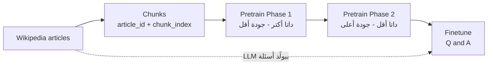
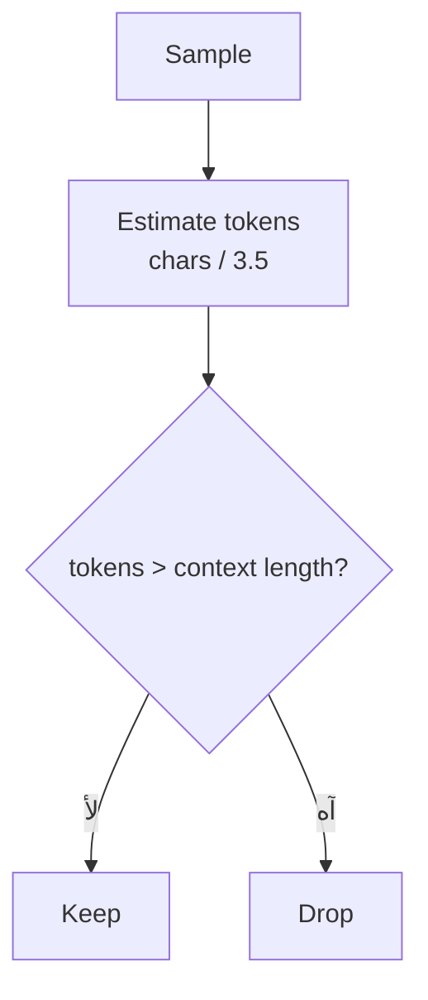

# Dataset Exploration — استكشاف داتا Jabarti

> **⬅️ Previous:** [[1. Introduction to Transformers]]  |  **➡️ Next:** Section 2 — Building a Bilingual Tokenizer
> **📂 Course:** [[LLM From Scratch - Index]]

> [!abstract] TL;DR
> - قبل أي training لازم **تستكشف الـ dataset** عشان تاخد قرارات صح (الـ training غالي، ولو اكتشفت المشكلة بعد كده يبقى خسرت فلوس ووقت).
> - الـ dataset الكويسة بتتقيّم على حاجتين: **اللغة** (سليمة ومتنوعة) و**المعرفة** (متنوعة في الـ pretrain، متخصصة في الـ finetune).
> - Jabarti = **bilingual** (عربي + إنجليزي) والمعرفة المستهدفة = **التاريخ المصري**.
> - الاستكشاف بيمشي كده: `schema → rows → nulls → duplicates → language distribution → text length → approx tokens → context window`.
> - النتيجة: `context length = 1024` بيحافظ على **~99%** من الـ pretrain data، و`512` بيضيّع 26–38% منها.
> - أهم درس: **اقرا samples بإيدك** — الأرقام ممكن تضلّلك.

> [!quote] افتتاحية المهندس
> «لما بتختار dataset لبناء language model لازم تشوف حاجتين أساسيتين: **اللغة** و**المعرفة**.»

---

## 1. إزاي تختار dataset لـ language model؟

| المحور | المطلوب | مثال |
|---|---|---|
| **اللغة (Language)** | عينات سليمة لغويًا، أخطاء لغوية قليلة قد الإمكان، و**تراكيب لغوية متنوعة** | عربي: جمع مذكر سالم، جمع مؤنث سالم، مبني للمجهول… |
| **المعرفة (Knowledge)** | في الـ pretrain: **معرفة عامة** في كل المجالات | تاريخ، أدب، رياضيات، فيزياء، طبخ… |

> [!tip] إزاي المشاريع الكبيرة بتشتغل
> المشاريع الكبيرة **ما بتحطش المعرفة المتخصصة من البداية**: بتجيب داتا **سليمة لغويًا** وبتغطي كل المواضيع في الـ pretrain، وبعدين التخصص بييجي في مرحلة الـ finetune / post-training.

**Jabarti بالذات:**
- **Bilingual**: بيتكلم عربي وإنجليزي.
- المعرفة متمركزة على **التاريخ المصري**. السبب بحسب المهندس: مفيش compute كفاية ولا ميزانية لداتا ضخمة، فالـ finetune data اتبنت حوالين التاريخ المصري.
- عشان كده لازم نتأكد إن الداتا **سليمة لغويًا**، وده اللي بنعمله في الـ exploration.

---

## 2. Pretrain vs Finetune

| | **Pretrain** | **Finetune** |
|---|---|---|
| شكل الداتا | **text خام** (مقالات متقطّعة chunks) | **Question / Answer** |
| الـ Input | جزء من نص | السؤال |
| الـ Output | الموديل **بيكمّل** النص | الموديل بيطلّع **الإجابة** |
| الـ Objective | **predict the next token** | **predict the next token** (نفس الفكرة) |
| بيعلّم الموديل | اللغة + المعرفة | إنه **يجاوب** على سؤال (assistant) |

> [!example] مثال المهندس
> بعد الـ pretrain لو كتبت جملة عن **كليوباترا** وسنة معينة، الموديل **هيكمّل** الكلام في نفس الموضوع. لكن مش مجهّز إنك تسأله سؤال وينتظر منه إجابة. ده بييجي في مرحلة **ما بعد التدريب (post-training)**: بنديله داتا على شكل **محادثة طويلة بين assistant و user** وبيحاول يكمّلها.

**اختبار الموديل بعد الـ pretrain:** تديله 3–4 كلمات وتقوله كمّل. بكده بتقيس **السلامة اللغوية** و**الدقة المعرفية** (هو مش بيعمل أكتر من إنه يكمّل).
**في الـ finetune:** نفس الـ next-token prediction، بس بدل ما تديله بداية فقرة، بتديله **السؤال** وهو **يكمّل بالإجابة**.



---

## 3. هيكل الـ dataset

**الـ repo:** `bakrianoo/jabarti-llm-dataset` على Hugging Face. فيه **configs** اتنين (`pretrain` و `finetune`) وتحت كل واحد **splits**.

| Config | Split | Rows |
|---|---|---:|
| `pretrain` | `phase1_train` | 175,476 |
| `pretrain` | `phase1_eval` | 2,000 |
| `pretrain` | `phase2_train` | 94,486 |
| `pretrain` | `phase2_eval` | 2,001 |
| `finetune` | `train` | 57,488 |
| `finetune` | `eval` | 6,379 |

> [!note] أرقام المهندس vs الـ notebook
> المهندس قال "175 ألف" و"94 ألف" و"حوالي 58 ألف" للـ finetune. الأرقام فوق من output الـ notebook بالظبط (الـ finetune train = 57,488).

### 3.1 الـ Pretrain

**فكرة الـ Phases (curriculum):** فيه trade-off بين **الكمية** و**الجودة**:
- لو ضغطت على جودة أعلى (فلترة وتنضيف أكتر) → **عدد الـ samples بيقل** (ممكن مليار يبقى 100 مليون) وكمان بيكلّفك فلوس ووقت أكتر في الفلترة.
- الحل: **تدرّب على مراحل**: المرحلة الأولى داتا **أكتر وجودة أقل**، والتانية داتا **أقل وجودة أعلى**.
- في Jabarti: Phase 1 = 175K row، Phase 2 = 94K row، وPhase 2 فيها **عربي أكتر** (شوف الـ language distribution تحت).

> [!warning] المهندس بيوضّح
> هو **ما كانش مخطط من الأول** إنه يدرّب على Phase 1 وبعدين Phase 2 بالترتيب. عادي جدًا إنك تعمل أكتر من split وبعدين تقرر تمشي بالتدريج، أو **تدمجهم كلهم** وتعمل مرحلة pretrain واحدة. الأفضل إنك **تحتفظ بكل metadata ممكنة** لأنها هتساعدك في الفلترة واتخاذ القرارات بعدين.

**المصدر:** Wikipedia. فيه جزء جاي من dataset بتاعة **Cohere Labs** ("Wikipedia 2023") بتتقسم حسب اللغة:
- العربي فيها **أكتر من 3.5 مليون record**.
- كل مقالة **متقسّمة لـ chunks**.
- المقالات **مترتبة حسب الشعبية** (pageviews/access على Wikipedia) → يعني بتلاقي المواضيع اللي الناس فعلًا مهتمة بيها (شخصيات، أماكن…) — مفيدة لو عايز تبني **experiment بتاعك**.

**فلترة الجودة:** مش كل مقالات Wikipedia متراجعة لغويًا كويس، فالمهندس طبّق أكتر من factor:
- **Baseline conditions** بسيطة (مثلًا مقالة قصيرة جدًا → تتشال).
- **LLM-as-judge**: LLM يحكم على جودة الداتا (فيها معلومات كتير؟ فيها أخطاء لغوية كتير؟).

**الأعمدة اللي المهندس اتكلم عنها:**

| العمود | الدور |
|---|---|
| `text` | **أهم عمود** — محتوى الـ chunk (ده اللي بيتدرّب عليه الموديل) |
| `title` | عنوان المقالة (مثلًا "قطاع التعدين في اليمن") |
| `url` | رابط المقالة على Wikipedia |
| `language` | `ar` أو `en` |
| `topic_domain` | المجال (history, geography, sports…) — بتستخدمه **للفلترة** |
| `is_person` | المقالة عن شخصية ولا لأ — كان عامله **للفلترة** |
| `article_id` + `chunk_index` | **المفتاح الفريد** لكل chunk (المقالة الواحدة بتتقطّع لأكتر من sample) |
| `category` | أحيانًا عربي وأحيانًا إنجليزي — **مش هنستخدمه** |

الـ schema الكاملة (26 عمود) فيها كمان: `page_id`, `record_id`, `pair_id`, `chunk_strategy`, `chunk_total`, `section_index`, `section_total`, `content_quality`, `is_stub_like`, `egypt_relevance`, `importance`, `pageviews_30d`, `sample_weight`, `ortho_convention`, `ortho_stripped`, `source_type`, `dataset_version`, `ds_source`. المهندس ما شرحش كل واحد فيهم.

### 3.2 الـ Finetune

- كل الداتا **متولّدة بالـ AI**: بدّي LLM المقالة وأطلب منه يولّد سؤال من أنواع مختلفة (**analytical / factual / temporal**… وأسئلة من/كيف/متى/أين) ومعاه إجابته.
- الأعمدة: `question`, `answer`, `type`, `difficulty` (**easy / medium / hard**), `language`, `article_title`, `qa_id`, `source_article_id`.
- **`source_article_id`** = بيربط السؤال بالمقالة اللي اتولّد منها في الـ pretrain. **ليه مهم؟** لأن الموديل المفروض يجاوب من **المعرفة اللي بناها في الـ pretrain** (يعني شاف مقالة "الإسكندر" في الـ pretrain، وبعدين بنسأله عنها في الـ finetune).
- الـ `difficulty` تقدر تستخدمه تدرّب على الـ easy بس أو على الكل.
- الـ **Input** وقت التدريب = `question`، والموديل بيتدرّب يولّد `answer`.

---

## 4. الكود خطوة بخطوة (من الـ notebook)

> [!info] الـ Runtime
> **CPU كفاية** هنا (مفيش GPU). اتأكد إنك connected وبعدين شغّل الخلايا بالترتيب.

### 4.1 التثبيت

```python
!pip install -qU datasets pandas
```

- `!` = بتنفّذ **shell command** من جوه Colab.
- `-q` = quiet (output أقل)، `-U` = upgrade لآخر نسخة.
- **`datasets`** (من Hugging Face) بتحمّل الـ dataset، و**`pandas`** بنستكشف بيها الـ data.

### 4.2 تحميل الـ data

```python
import pandas as pd
from datasets import load_dataset

REPO = "bakrianoo/jabarti-llm-dataset"

pretrain = load_dataset(
    REPO,
    "pretrain",
    split="phase1_train"
).to_pandas()

finetune = load_dataset(
    REPO,
    "finetune",
    split="train"
).to_pandas()
```

| الجزء | معناه |
|---|---|
| `REPO` | الـ **repo ID** (بتنسخه من صفحة الـ dataset على HF) |
| `"pretrain"` / `"finetune"` | **config name** (الـ subset) |
| `split="phase1_train"` | أنهي split بالظبط عايز تحمّله |
| `.to_pandas()` | بيحوّل الـ HF `Dataset` لـ **pandas DataFrame** عشان نستكشفه |

> [!note] التحذير في الـ output
> هتشوف warning: *"You are sending unauthenticated requests to the HF Hub"* — مش error. ممكن تعمل `HF_TOKEN` عشان rate limits أعلى وتحميل أسرع. و`Resolving data files` معناه إنه بيحلّل ملفات الـ dataset قبل التحميل.

### 4.3 الـ Schema

```python
print("Pretrain Schema")
print(pretrain.dtypes)

print("\nFinetune Schema")
print(finetune.dtypes)
```

`df.dtypes` بتعرض **اسم كل عمود + نوعه**. اللي يهمنا:
- Pretrain: `title` و`text` (**string**) ← **`text` أهم عمود**.
- Finetune: `question` و`answer` ← أهم حاجتين.

> [!note] ظهور `str` بدل `object`
> في الـ output النوع بيظهر `str` (نسخ pandas الجديدة). في نسخ أقدم هتشوفه `object` — نفس المعنى (string).

### 4.4 الـ splits dictionary + الـ loop

```python
splits = {
    "pretrain / phase1_train": ("pretrain", "phase1_train"),
    "pretrain / phase1_eval":  ("pretrain", "phase1_eval"),
    "pretrain / phase2_train": ("pretrain", "phase2_train"),
    "pretrain / phase2_eval":  ("pretrain", "phase2_eval"),

    "finetune / train": ("finetune", "train"),
    "finetune / eval":  ("finetune", "eval"),
}
```

- كل **key** = label للطباعة، والـ **value** = tuple `(subset, split_name)`.
- بعدين بنلف عليهم:

```python
for label_name, (subset, split_name) in splits.items():
    df = load_dataset(REPO, subset, split=split_name).to_pandas()
    print(f"\n===== {label_name} =====")
    print("ROWS:", df.shape[0])
```

> [!tip] Tuple unpacking
> بدل ما تاخد الـ tuple كلها كـ متغير واحد، بتفكّه في نفس سطر الـ `for`: `(subset, split_name)`. المهندس بدأ بالـ tuple وبعدين فكّه وقال إنها **طريقة أحسن**.

- `df.shape` بيرجّع `(rows, columns)` → `df.shape[0]` = **عدد الصفوف**.

**كل اللي بعد كده بيتنفّذ جوه الـ loop على كل split.**

### 4.5 فحص الـ Null values

```python
nulls = df.isnull().sum()
nulls = nulls[nulls > 0]

print("NULL VALUES:")
print("None" if nulls.empty else nulls.to_string())
```

1. `df.isnull()` ← DataFrame من `True/False` (True = القيمة فاضية).
2. `.sum()` ← عدد الـ nulls **في كل عمود**.
3. `nulls[nulls > 0]` ← **فلتر**: سيب بس الأعمدة اللي فيها nulls.
4. لو الناتج `empty` اطبع `"None"` وإلا اطبعه كنص بـ `.to_string()`.

**النتيجة:** `None` في **كل الـ splits** ← مفيش أي null في أي عمود.

> [!tip]
> الكود ده بتستخدمه مع **أي DataFrame** (CSV / parquet…). ولو لقيت nulls، **القرار بتاعك**: تكمل ولا تنضّف.

### 4.6 فحص الـ Duplicates

```python
df = load_dataset(REPO, "pretrain", split="phase1_train").to_pandas()

# Check duplicate text
text_dups = df.duplicated(subset=["text"]).sum()
print(f"Rows with exact duplicate text: {text_dups}")

# Check duplicate article_id + chunk_index
pair_dups = df.duplicated(subset=["article_id", "chunk_index"]).sum()
print(f"Duplicate (article_id, chunk_index) pairs: {pair_dups}")
```

- `df.duplicated(subset=[...])` بيرجّع Series من `True/False`: **True** لأي صف **متكرر** (بيعتبر أول ظهور مش duplicate، والباقي duplicates). و`.sum()` بيعدّ الـ `True`.
- فيه **مستويين** للفحص:
  1. **على column واحد (`text`)**: في نفس النص متكرر بالحرف؟
  2. **على pair (`article_id`, `chunk_index`)**: المقالة بتتقسّم chunks، فالـ pair ده **المفروض عمره ما يتكرر** (مفيش اتنين records ليهم نفس الـ article id ونفس الـ chunk index).

**النتيجة:** `0` و`0` ← مفيش duplicates (على `phase1_train`).

> [!warning] الفحص ده اتعمل على `phase1_train` بس
> لو عايز تتأكد من باقي الـ splits حطّه جوه الـ loop. وكمان بيعدّ **exact duplicates** بس، يعني نص متكرر بتغيير بسيط ممكن يعدّي.

### 4.7 الـ Enum columns (مذكورة في الشرح)

الأعمدة اللي قيمها محدودة (**enum values**) زي `language` (`ar`/`en`) و`is_person` (True/False) و`topic_domain`. بتستكشفها بـ `value_counts()`:

```python
df["topic_domain"].value_counts()   # إضافة مني: مثال بسيط
```

المهندس قال إن Colab بيوفّر **interactive table** تقدر تفلتر بيها وانت شغال، ولذلك وحّد اسم عمود اللغة `language` في كل الـ splits.

### 4.8 الـ Language Distribution

```python
lang_counts = df["language"].value_counts()
total_rows = df.shape[0]

for lang, n in lang_counts.items():
    print(
        f"{lang} => {n} samples",
        f"{n / total_rows * 100:.1f}%"
    )
```

- `value_counts()` بيرجّع Series: الـ **index = القيمة** (`en`, `ar`) والـ **value = عدد المرات**.
- `.items()` بتخلّينا نلف عليها `(lang, n)`.
- `n / total_rows * 100` = **النسبة المئوية**، و`:.1f` = رقم عشري واحد بعد الفاصلة (f-string formatting).

**النتايج:**

| Split | Arabic | English |
|---|---:|---:|
| `phase1_train` | 28.3% | **71.7%** |
| `phase1_eval` | 28.7% | 71.3% |
| `phase2_train` | **55.3%** | 44.7% |
| `phase2_eval` | 53.6% | 46.4% |
| `finetune/train` | **78.2%** | 21.8% |
| `finetune/eval` | 78.0% | 22.0% |

**الاستنتاجات:**
- **Phase 1 إنجليزي أكتر** (71%) لأن الـ Wikipedia الإنجليزي عن التاريخ المصري **أكبر بكتير** من العربي. في **Phase 2** المهندس قلّل الإنجليزي وزوّد العربي فبقوا قريبين.
- نسب الـ **eval ≈ نسب الـ train** في كل مرة ← دليل إن الـ split **stratified** (موزّع كويس).
- الـ finetune **العربي فيها غالب** (78%).

> [!quote] المهندس عن الـ bias
> «أنا مش بدافع عن الداتا اللي وصّلتها — مهما بذلت فيها كان لازم أقف عند مرحلة معينة وأبدأ الكورس. في **أي داتا bilingual في الواقع** لازم يحصل **bias** ناحية لغة. ودي مهارتك كواحد بتصمّم التجربة: تشوف الواقع اللي عندك وتحاول تظبطه.»

مثال على قرار ممكن تاخده: في الـ finetune تشيل جزء من العربي عشان تقرّب النسب. **القرار بتاعك** — المهم إن الاستكشاف بيخلّيك تاخد القرار وانت عارف الأرقام.

### 4.9 توزيع طول النص (بالحروف)

```python
text_len_dist = 0

if subset == "pretrain":
    text_len_dist = (
        df["text"]
        .astype(str)
        .str.len()
        .describe()
        .round(1)
    )

elif subset == "finetune":
    text_len_dist = (
        pd.concat(
            [
                df["question"].astype(str).str.len(),
                df["answer"].astype(str).str.len()
            ],
            ignore_index=True
        )
        .describe()
        .round(1)
    )

print("\n===== Text Length Distribution =====")
print(text_len_dist)
```

**الـ pipeline في pretrain (سطر واحد):**

| الخطوة | بتعمل إيه |
|---|---|
| `df["text"]` | عمود النص |
| `.astype(str)` | تأكيد إنه string (احتياطي) |
| `.str.len()` | **طول كل نص بالحروف** |
| `.describe()` | إحصائيات: `count, mean, std, min, 25%, 50%, 75%, max` |
| `.round(1)` | تقريب لرقم عشري واحد |

**في الـ finetune:** `pd.concat([...])` بتجمّع **طول الـ question وطول الـ answer** في Series واحدة. `ignore_index=True` بتعمل index جديد نضيف.

> [!warning] انتبه: فيه "concatenation" بمعنيين في الـ notebook
> - **هنا (توزيع الطول بالحروف):** `pd.concat` بيرصّ أطوال الأسئلة **وبعدها** أطوال الإجابات في نفس الـ Series. عشان كده `count = 114,976` (= 2 × 57,488). يعني بتشوف توزيع **طول أي نص سواء سؤال أو إجابة**.
> - **في الـ approx tokens (الخطوة الجاية):** بنجمع `question + answer` **لكل صف** بعلامة `+`، يعني sample واحدة = سؤال + إجابته.
>
> نفس الكلمة، بس النتيجة مختلفة. وبخصوص `ignore_index=True`: المهندس قال إنه عشان الإحصائية ما تتلخبطش، لكن `describe()` فعليًا مش بتتأثر بالـ index — فهي عادة نضيفة أكتر منها ضرورة.

**النتايج:**

| | count | mean | min | 25% | 50% | 75% | max |
|---|---:|---:|---:|---:|---:|---:|---:|
| `pretrain / phase1_train` (chars) | 175,476 | **1553.0** | 178 | 1169 | 1653 | 1913 | **20,049** |
| `finetune / train` (chars) | 114,976 | 92.1 | 10 | 56 | 77 | 111 | 423 |

يعني في الـ pretrain بتلاقي نص طوله **178 حرف** ونص طوله **20 ألف حرف**، وفي الـ finetune النصوص **قصيرة جدًا** (متوسط ~92 حرف).

---

## 5. الأهم: Characters vs Tokens و الـ Context Window

> [!important] الـ LLM مش بيحسب حروف
> وانت بتصمّم language model **بتحسب بعدد الـ tokens** مش الحروف. والـ tokenizer هنبنيه في Section 2 — فلحد ما نبنيه، هنعمل **تقدير تقريبي**.

**الـ Max Length / Context Window** = أقصى عدد tokens الموديل يقدر يتعامل معاه، و**الـ input والـ output مع بعض ما يعدّوش الحد ده**:

$$\text{input tokens} + \text{output tokens} \le \text{context length}$$

مثال المهندس: لو الـ max length = 1000 token والـ input = 100، يبقى الـ output ممكن يوصل لـ 900 كحد أقصى.

**إزاي بتحدد الـ context window؟**
- هي بتحجز **memory** (في الـ training وفي الـ generation) → ما ينفعش تحطها كبيرة من غير حساب.
- ولو حطيتها **ضيقة قوي**، هتضطر **تستبعد** عدد كبير من الـ samples.

**لو الـ sample أطول من الـ context length هتعمل إيه؟**
- **Truncation** (تقطع عند الحد): ده **"hard / dumb truncation"** ممكن يقطع في نص الكلام ويبوّظ المعنى (والـ LLM بيتأثر بداتا ناقصة).
- **Drop** (تسيبها خالص): المهندس **بيفضّل ده** — أحسن إنك تاخد جزء وتسيب جزء.

ولذلك بنختبر **كذا context length** ونشوف هنحتفظ بكام ونسقط كام:



### 5.1 الـ Approximate Tokens

```python
CHARS_PER_TOKEN = 3.5
CONTEXT_LENGTHS = [512, 1024, 2048]
```

- **`CHARS_PER_TOKEN = 3.5`**: افتراض إن الـ token الواحد في المتوسط بيشيل **3–4 حروف** فناخد **3.5**.
- **`CONTEXT_LENGTHS`**: الـ candidates اللي هنختبرها (512 / 1024 / 2048).

```python
if subset == "pretrain":
    sample_characters = df["text"].astype(str).str.len()

elif subset == "finetune":
    sample_characters = (
        df["question"].astype(str).str.len()
        +
        df["answer"].astype(str).str.len()
    )

approx_tokens = (sample_characters / CHARS_PER_TOKEN).astype(int)
```

- **pretrain**: الـ sample = عمود `text` بس.
- **finetune**: الـ sample = **`question + answer`** (طول الاتنين مع بعض لكل صف) لأن الاتنين بيدخلوا الموديل سوا.
- القسمة على `3.5` تحوّل الحروف لـ **tokens تقريبية**، و`.astype(int)` تحوّلها لأرقام صحيحة (بتقطع الكسر).

```python
print("\n===== Approximate Token Length =====")
print(approx_tokens.describe().round(1))
```

| `phase1_train` — approx tokens | القيمة |
|---|---:|
| mean | **443.3** |
| 50% | 472 |
| max | **5,728** (= 20,049 ÷ 3.5) |

### 5.2 الـ Context Window Analysis

```python
for context_length in CONTEXT_LENGTHS:

    drop_percentage = (approx_tokens > context_length).mean() * 100
    keep_percentage = 100 - drop_percentage

    print(
        f"Context Length: {context_length} | "
        f"Keep: {keep_percentage:.1f}% | "
        f"Drop: {drop_percentage:.1f}%"
    )
```

**الحيلة هنا:** `(approx_tokens > context_length)` بتعمل Series من `True/False` (True = الـ sample **أطول** من الحد). `True` بتتحسب `1` و`False` `0`، فـ **`.mean()` = نسبة الـ True** (الكسر اللي هيتشال)، ونضربها في 100 عشان نجيب **drop %**. والـ keep = `100 - drop`.

**النتايج (Keep % لكل context length):**

| Split | 512 | 1024 | 2048 |
|---|---:|---:|---:|
| `pretrain / phase1_train` | 61.9% | 99.3% | 99.8% |
| `pretrain / phase1_eval` | 61.4% | 99.4% | 99.9% |
| `pretrain / phase2_train` | 73.5% | 99.0% | 99.7% |
| `pretrain / phase2_eval` | 73.6% | 99.3% | 99.8% |
| `finetune / train` | 100% | 100% | 100% |
| `finetune / eval` | 100% | 100% | 100% |

(الـ finetune: أطول sample ≈ **197 token** بس، فكلها بتدخل في أي context.)

### 5.3 القرار

> [!success] قرار المهندس
> - **512 ❌**: هيسقط **26–38%** من الـ pretrain data → كتير قوي.
> - **1024 vs 2048**: الفرق في الـ keep **أقل من 1%** (99.3% ← 99.8%) بس مضاعفة الـ context window معناها **GPU/RAM أكتر في الـ training**. **هل الـ <1% دول مستاهلين؟ لأ** — فالمهندس بيفضّل **1024** (حوالي 99%+ راضي بيها).

**تحفظات (إضافة مني):** الـ `3.5` قيمة **تقريبية** (ممكن تختلف بين العربي والإنجليزي وحسب الـ tokenizer). لما نبني الـ bilingual tokenizer في Section 2 يبقى نعيد الحساب بعدد الـ tokens الحقيقي.

---

## 6. الدرس الأهم: اقرا الداتا بإيدك

> [!quote] المهندس
> «الأدوات اللي عملناها بتديك أرقام وقرارات، لكن لازم **حرفيًا تاخد samples من الداتا وتطلعها في text file وتقعد تقرا**. كل ما تعمل update على الداتا خد samples عشوائية واقراها. العشر دقايق اللي هتبذلهم كل كام يوم **هتطلع منهم بكام note مهمين جدًا**.»

- الأرقام ممكن تكون **مضللة**: كونفجريشن بسيط أو كود غلط **مش هيطلّعلك error**، هيطلّعلك رقم غلط وانت مش واخد بالك.
- مفيش حاجة أفضل من **الـ manual inspection** في الحكم على الداتا.
- مش كل note هتوصّلك لحل، بس على الأقل **بتعرف إيه اللي في إيدك**.
- مرحلة الـ data exploration = **bottleneck**: يا الداتا تعدّي سليمة يا لأ، **وده ممكن يخلّي التجربة كلها تنجح أو تفشل**.
- كل ما بذلت مجهود في المرحلة دي، كل ما بقيت **واثق** أكتر قبل ما تبدأ تصرف فلوس على التدريب.

**تمرين بسيط (إضافة مني):**

```python
sample = pretrain.sample(20, random_state=42)

with open("pretrain_samples.txt", "w", encoding="utf-8") as f:
    for _, row in sample.iterrows():
        f.write(f"### {row['title']} ({row['language']})\n{row['text']}\n\n{'-' * 80}\n\n")
```

- `sample(20, random_state=42)` = 20 صف عشوائي (والـ `random_state` بيثبّت العينة عشان تقدر ترجع لها).
- بتكتبهم في ملف `.txt` وتقراه، واكتب notes.

---

## 7. Checklist الاستكشاف (reusable)

1. **Schema**: `df.dtypes` — أهم الأعمدة إيه؟
2. **Splits & rows**: `df.shape[0]` لكل split.
3. **Nulls**: `df.isnull().sum()` ثم فلتر `> 0`.
4. **Duplicates**: على column (`text`) وعلى pair (`article_id`, `chunk_index`).
5. **Enum columns**: `value_counts()` (language / topic_domain / is_person).
6. **Language distribution** + مقارنة train بـ eval.
7. **Text length** بالحروف: `.str.len().describe()`.
8. **Approx tokens**: `chars / CHARS_PER_TOKEN`.
9. **Context window analysis**: keep/drop % لكل candidate.
10. **Manual reading** لـ samples عشوائية + notes.

---

## 8. تنبيهات على الـ transcript (ASR)

- **"library train" / "LibreTrain"** = `pretrain`. و**"فيز ون / فيز تو"** = `phase1 / phase2`.
- **"trainfix2"** غير واضحة (غالبًا بيشرح إن `source_article_id` بيشاور على article/sample في الـ pretrain).
- **"كوهير لابس"** = Cohere Labs.
- أرقام الـ notebook (rows, percentages, keep/drop) متحقق منها من الـ outputs المحفوظة فيه.

## 9. مواضيع مفتوحة

- بناء الـ **Bilingual Tokenizer** (Section 2) ← وبعدها نعيد حساب الـ approximate tokens بالـ tokenizer الحقيقي بدل `3.5`.
- قرار نسبة العربي/الإنجليزي في الـ pretrain والـ finetune (bias) لسه مفتوح.
- القرار النهائي لـ **context length** (1024 المرجّح).
- Phase 1 → Phase 2 sequentially ولا دمجهم في stage واحدة؟
- مراجعة samples بإيدك وتسجيل notes.
